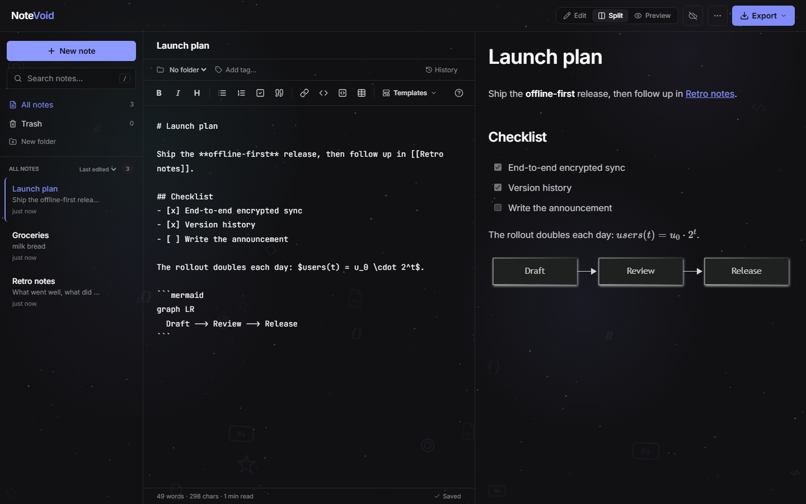
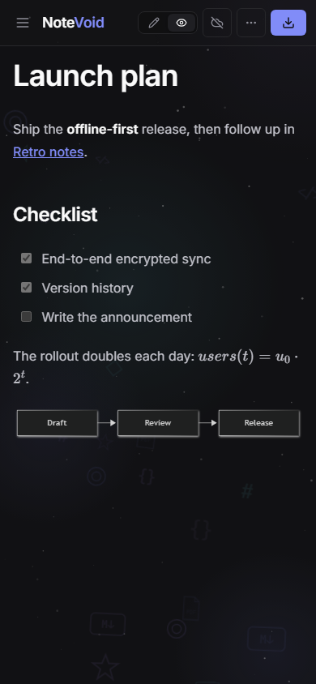

# NoteVoid

A local-first Markdown notes app: live preview, wiki links, folders and
tags, math and diagrams, version history, a command palette, light and dark
themes, English and Ukrainian, and optional end-to-end encrypted sync between
devices. Notes live in the browser (IndexedDB) and the app works offline; the
sync server is opt-in.

Built with **Next.js 16** (App Router + Route Handlers), **React 19**,
**TypeScript** (strict) and **Tailwind CSS 4**. No UI or state libraries. In
the browser: `react-markdown` with `remark-gfm`, `html2pdf.js`, and KaTeX and
Mermaid loaded only when a note needs them; on the server, `pg` when sync is
backed by Postgres. Encryption uses the built-in Web Crypto API.



<details>
<summary>Mobile layout</summary>



</details>

---

## Features

**Writing**
- Live GFM preview (tables, task lists, strikethrough) with edit, split and
  preview-only modes.
- **Wiki links**: `[[Note title]]` or `[[Note title|text]]` opens that note,
  or creates it; each note lists the notes that link to it.
- **Math** with KaTeX (`$…$`, `$$…$$`) and **diagrams** with Mermaid
  (```` ```mermaid ````), both loaded only when a note uses them.
- **Version history**: earlier versions of each note are kept on the device
  every few minutes while editing, and any of them can be restored.
- **Syntax highlighting** for TypeScript/JavaScript, JSON, CSS, HTML, bash and
  Python, using an in-house tokenizer with no dependencies. Code blocks show
  their language and have a Copy button.
- Formatting toolbar and shortcuts. Native **Ctrl + Z** keeps working after
  toolbar actions. Enter continues or ends lists.
- Templates, a Markdown cheatsheet, and word count with reading time.

**Organizing**
- **Folders**: create, rename and delete them (deleting a folder keeps its
  notes) and filter the list by folder.
- **Tags**: chip input with suggestions; filter by tag; search also matches
  tags.
- Pinning, and full-text search that highlights matches and shows the text
  around them.
- **Drag and drop** notes onto a folder, out of folders, or into the trash;
  sort the list by last edit, creation or title.
- **Command palette** (`Ctrl/Cmd + Shift + P`, or `Ctrl/Cmd + K` outside the
  editor) to jump to any note or run any command.
- **Trash**: deleted notes wait 30 days, can be opened read-only, restored or
  deleted forever. The trash syncs, so a note deleted on one device can be
  restored on another.
- The list sorts by and shows the last **edit** of the text; pinning,
  tagging or moving a note does not count as editing it.

**Data**
- **IndexedDB storage** with one record per note, debounced incremental
  writes, a visible save status, and cross-tab updates via `BroadcastChannel`.
- **Import** `.md`/`.txt` files from the menu or by dropping them onto the
  window.
- **Backup**: download every note and folder as JSON, and restore it later,
  including notes deleted since the backup.
- **Export** a note as a PDF or a `.md` file.
- **Sync** (optional, **end-to-end encrypted**): turn it on, copy the sync
  key, paste it on another device. The server only ever sees ciphertext.
  Changes merge in both directions, and when two devices edit the same note
  between syncs **neither text is lost**: the overwritten one is kept as a
  note marked "conflict copy".

**Offline and security**
- **Installable PWA** that opens and works without a network after the first
  visit (service worker caches the app shell; notes are already local).
- **Nonce-based Content Security Policy** plus hardening headers, and a
  rate-limited sync endpoint.

**Quality**
- **Light and dark themes**, following the system by default, with no flash
  of the wrong theme on load.
- **English and Ukrainian**, chosen from the browser language or the menu,
  with correct plural forms.
- Responsive layout (the notes list is a drawer on phones). Semantic markup,
  labelled controls, focus rings, WCAG AA contrast, `prefers-reduced-motion`.

### Keyboard shortcuts

| Shortcut | Action |
| --- | --- |
| `Alt + N` | New note (in the current folder) |
| `/` | Focus search |
| `Ctrl/Cmd + Shift + P` | Command palette (also `Ctrl/Cmd + K` outside the editor) |
| `Ctrl/Cmd + B`, `I`, `K` | Bold, italic, link |
| `Enter` in a list | Continue or end the list |
| `Esc` | Close menus and dialogs, clear search, close the drawer |

---

## Architecture

```
                 ┌──────────── browser ─────────────────────────────┐
 UI components ──► useNotes ──► notesStore ──► notesReducer (pure)  │
                 │                 │  ▲                            │
                 │                 │  └── BroadcastChannel (tabs)  │
                 │                 ▼                               │
                 │          NotesPersistence ── IndexedDB          │
                 │          (localStorage fallback)                │
                 │                                                 │
                 │  useSync ──► syncClient ── POST /api/sync ──────┼──► Route Handler
                 └─────────────────────────────────────────────────┘     └► mergeData ► SyncRepository
```

### Layers

The code is organised by feature, not by kind of file. Everything a
feature needs (components, hooks, pure logic and its tests) sits in one
folder, so a change to sync, say, stays inside `src/features/sync`.

| Layer | Folder | What belongs there |
| --- | --- | --- |
| Routes | [`src/app/`](src/app/) | Next.js routes only: the layout, the page (one `<Workspace />`), the manifest and the `/api/sync` route |
| Features | [`src/features/`](src/features/) | One folder per feature, listed below |
| Shared | [`src/shared/`](src/shared/) | Building blocks that know nothing about notes: UI primitives, hooks, text and clock helpers, translations, security headers |

The dependency rules are enforced by ESLint (`no-restricted-imports` in
[`eslint.config.mjs`](eslint.config.mjs)), so `npm run lint` fails when one
is broken:

- `shared` imports neither features nor routes;
- features never import routes;
- `notes`, the core model, depends on no other feature;
- browser code never imports the sync server, so server code cannot end up
  in the client bundle.

### Features

| Feature | Responsibility | Key files |
| --- | --- | --- |
| [`notes`](src/features/notes/) | The core: model, pure reducer and merge, validation, the store, IndexedDB/localStorage persistence | `model/types`, `model/reducer`, `model/merge`, `model/schema`, `state/store`, `persistence/indexedDb` |
| [`library`](src/features/library/) | The sidebar: folders, tags, trash, the note list | `Sidebar`, `LibraryNav`, `NoteItem` |
| [`editor`](src/features/editor/) | Writing: textarea, toolbar, shortcuts, folder and tag field, templates | `Editor`, `Toolbar`, `lib/markdownActions` |
| [`markdown`](src/features/markdown/) | Rendering: preview, syntax highlighting, wiki links and backlinks, KaTeX, Mermaid | `Markdown`, `lib/highlight`, `lib/wikiLinks`, `lib/extras` |
| [`history`](src/features/history/) | Local version history and its dialog | `history`, `noteHistory`, `HistoryDialog` |
| [`sync`](src/features/sync/) | Encrypted sync, split into `shared` (protocol, wire format), `client` (sync client, crypto, UI) and `server` (handler, conflicts, repositories, rate limits) | `client/syncClient`, `client/crypto`, `server/handler` |
| [`transfer`](src/features/transfer/) | Import, backup and export | `importExport`, `ExportMenu`, `DropOverlay` |
| [`palette`](src/features/palette/) | The command palette and fuzzy matching | `CommandPalette`, `fuzzy` |
| [`theme`](src/features/theme/) | Light, dark and system themes | `theme`, `ThemeController` |
| [`offline`](src/features/offline/) | Service worker registration | `ServiceWorker` |
| [`workspace`](src/features/workspace/) | The app shell that wires features together and owns cross-feature UI state | `Workspace`, `useLibraryView`, `useNoteActions`, `useCommands`, `NotePane` |

### Design decisions

- **`useSyncExternalStore` instead of `useEffect` + `setState`.** Storage is
  an external system. A server snapshot plus a client snapshot avoids
  hydration mismatches and cascading renders.
- **The logic has no React and no DOM.** The reducer, merge, validation,
  highlighter, import parsing and the sync handler are plain functions. The
  store and the sync client get their persistence, clock, ID generator, timers
  and `fetch` injected. That is why 194 unit tests run in about 3 seconds with no
  browser.
- **IndexedDB with incremental writes.** The store diffs note references
  between states, collects the changed IDs, and writes only those records plus
  a small metadata record, so typing in one note does not re-serialize the
  whole collection. Writes are debounced and serialized. Data stored by earlier
  builds in localStorage migrates once.
- **No lost edits on close.** An IndexedDB transaction started in `pagehide`
  may not finish, so the pending change is also written synchronously to a
  small localStorage journal, which is replayed on the next load.
- **Sync as a commutative merge.** Every entity has an `updatedAt`, and
  deletions leave tombstones. `mergeData` keeps the newest version, drops
  anything deleted after its last edit, and moves notes out of deleted
  folders. Because the merge is commutative and idempotent, the server and
  every device converge whatever the order of requests. Exact `updatedAt`
  ties are broken by content, not by argument order. Restoring from the trash
  or a backup bumps `updatedAt`, so the restore wins everywhere.
- **Clocks are not trusted.** Each sync measures the device's clock offset
  from the server time and the request midpoint; every timestamp comes from
  the corrected clock, and the offset is persisted. The reducer also stamps
  each change at least 1 ms after the version it was made on, so an edit or
  deletion always beats the version the user saw, even one a fast clock
  dated in the future.
- **No silent loss on conflicts.** Clients send `since`, the moment of their
  last merged snapshot, and a device id; notes record `editedBy`. Before
  merging, the server finds text that last-write-wins would drop: the
  device's own edits made after `since`, or other devices' edits it has not
  seen. It keeps each as a copy marked with `conflictOf`, whose id derives
  from the lost version, so retries cannot duplicate it. `editedBy` rules out false
  alarms from text the device merely received and sent back, or its own
  earlier text from a reply that never arrived.
- **A synced soft-delete.** Deleting sets `trashedAt`, which syncs like any
  field. Only purging (manually or after 30 days) leaves a tombstone.
- **`updatedAt` versus `editedAt`.** `updatedAt` is the sync version and
  moves on every change; `editedAt` moves only when title or text change and
  is what the UI shows and sorts by.
- **End-to-end encryption.** The sync key, a random 144-bit secret, never
  leaves the device. HKDF-SHA256 derives three keys from it: a space token
  sent in its place (the server files data under the token's SHA-256), an
  AES-GCM-256 key that seals titles, text, tags and folder names with a
  fresh IV, and an HMAC key for a hash of each note's text. Every blob is
  bound to its entity's id as AES-GCM additional data, so the server cannot
  move one note's text onto another. Ids, timestamps, pin, folder and trash
  state stay readable, because the server merges and detects conflicts with
  them; it compares texts only through their keyed hashes. A conflict copy
  is marked with `conflictOf` rather than renamed, since the server cannot
  rename what it cannot read. Earlier, unencrypted clients get `426`, and a
  device's first encrypted sync erases its old plaintext space, naming it by
  the hash of the key it was stored under so the key is not sent again.
  Lose the key and the synced copy cannot be recovered; each device keeps
  its own local copy regardless.
- **Optimistic concurrency, so it scales out.** Storage sits behind a
  two-method `SyncRepository`; writes only succeed over the version that was
  read, and the handler retries with fresh data when another instance won.
  Postgres (one row per space, used when `DATABASE_URL` is set) makes that
  safe across instances; JSON files (atomic temp-file + rename) suit one
  server. Requests are also serialized per space within a process. One
  contract test runs every repository, Postgres on in-process PGlite.
- **Delta sync.** The server versions each space and records the version at
  which every note, folder and tombstone last changed. Clients keep the last
  version as a cursor: after the first full exchange of a page load, they
  send only what changed since their last snapshot and receive only what
  changed after the cursor.
- **Tombstones expire.** After 90 days they are pruned on the server and on
  every device. The server remembers the newest pruned deletion (the
  horizon) and ignores unknown entities older than it from a device that has
  not synced since, so a long-offline device cannot revive deleted notes.
- **Data from outside is untrusted.** Storage, backups and API bodies all go
  through the same validators. Malformed entries are dropped, and payloads and
  files are size-limited.
- **Native undo.** Toolbar edits use `execCommand("insertText")` on the
  changed range, so the browser undo stack survives. If the browser refuses,
  the edit falls back to a state update.
- **Rendering cost.** The preview uses `useDeferredValue`, highlighting is
  memoised per block and skipped for huge blocks, merges keep object identity
  for unchanged notes (memoised rows don't re-render), and the PDF tree and
  `html2pdf.js` load only during export.
- **Offline without a library.** A small hand-written service worker
  (`public/sw.js`) serves navigations network-first with a 3 s timeout and a
  cached fallback, and hashed `/_next/static` files cache-first. It precaches
  the page and everything it references on install, and the page hands over
  chunks it loaded before the worker took control, so the first visit is
  already complete offline. It is registered only in production builds.
- **Typed translations.** All UI strings live in one dictionary; the
  Ukrainian one is typed as the English one's shape, so a missing key fails
  the build. Counts use `Intl.PluralRules` (Ukrainian has three forms). The
  server renders English and the client switches after hydration through
  `useSyncExternalStore`, so there is no hydration mismatch.
- **A theme without a flash.** Themes are the same design tokens with a
  second palette under `[data-theme="light"]`. A one-line script in `<head>`,
  carrying the request's CSP nonce, sets the theme before the first paint.
- **History by observation.** A recorder subscribes to the store and, when a
  note's text changes, saves the version from just before the change, at most
  every five minutes per note, in its own IndexedDB object store. That covers
  edits and text replaced by sync alike, without touching the reducer.
- **Heavy features load on demand.** KaTeX and Mermaid are dynamic imports
  triggered by the content itself; Mermaid runs in strict mode, which
  sanitizes the SVG it returns.
- **Defence in depth against XSS.** The sync key sits in `localStorage`, so
  `proxy.ts` sends a per-request nonce CSP with `'strict-dynamic'`: only
  scripts Next.js stamped can run, lazily loaded chunks still work, and
  injected inline handlers are blocked. The root layout renders per request
  so the nonce can be applied.
- **Rate limiting before work.** Token buckets limit sync requests per IP
  before the body is read and per space before any storage access, and
  return `429` with `Retry-After`, which the sync client honours.

---

## Getting started

Requirements: **Node.js 20+**.

```bash
npm install
npm run dev
```

Open [http://localhost:3000](http://localhost:3000).

### Sync server configuration

The sync API runs inside the Next.js server, so no separate service is needed.

| Variable | Default | Description |
| --- | --- | --- |
| `DATABASE_URL` | unset | Postgres connection string. When set, sync spaces live in Postgres (the table is created on first use) and any number of instances can serve sync |
| `SYNC_DATA_DIR` | `.data/sync` | Without `DATABASE_URL`: where sync spaces are stored (one JSON file each) |
| `SYNC_DISABLED` | unset | Set to `true` to turn the endpoint off |
| `SYNC_RATE_LIMIT_IP` | `120` | Sync requests per minute per client IP (`0` turns it off) |
| `SYNC_RATE_LIMIT_SPACE` | `240` | Sync requests per minute per sync space (`0` turns it off) |

The per-IP limit reads `X-Forwarded-For`, so behind a reverse proxy make sure
the proxy sets it. Limits are kept in memory, which suits a single server.

On serverless hosts with a read-only file system, set `DATABASE_URL` (for
example a managed Postgres such as Neon, Supabase or RDS).

### Deploying

1. Create a Postgres database and copy its connection string.
2. Deploy the app to any Node.js host (`npm run build && npm start`), or to a
   platform with Next.js support, with `DATABASE_URL` set.
3. Put it behind HTTPS. If the host does not set `X-Forwarded-For`, the
   per-IP limit applies to all clients together.

#### Neon

The database for the hosted demo is [Neon](https://neon.com) Postgres. The
project is described in [`neon.ts`](neon.ts), and the Neon CLI provisions it
and writes the connection strings to `.env.local`:

```bash
neon login
neon deploy      # applies neon.ts and pulls the variables
```

Use the **pooled** `DATABASE_URL` (PgBouncer) for the app: the sync queries
need no session state, so they are safe through the pooler. Keep
`DATABASE_URL_UNPOOLED` for migrations and dumps. The app keeps using the
`pg` driver, which suits a long-running Node server; on an edge runtime you
would switch to Neon's serverless driver. The table is created on first use.

`pg` currently treats `sslmode=require` as `verify-full` and prints a warning
about the semantics changing in its next major version; setting
`sslmode=verify-full` in the URL keeps today's behaviour and silences it.

Rate limits and the per-space lock live in each instance's memory, so with
several instances the limits apply per instance; correctness does not depend
on them.

## Scripts

| Command | Description |
| --- | --- |
| `npm run dev` | Start the dev server |
| `npm run build` / `npm start` | Production build and server |
| `npm run lint` | ESLint (Next.js core-web-vitals + TypeScript rules) |
| `npm run typecheck` | `tsc --noEmit` |
| `npm run test:unit` | Unit tests (`src/**/*.test.ts`) |
| `npm run test:coverage` | Unit tests with V8 coverage; fails below the thresholds in `.c8rc.json` |
| `npm run test:e2e` | Playwright end-to-end tests |
| `npm test` | Unit tests, then end-to-end tests |
| `npm run check` | Lint, typecheck and unit tests with coverage |

## Testing

- **Unit tests** (`src/**/*.test.ts`, 194 tests) cover the reducer, the merge
  (examples plus **property-based tests** with fast-check: random replicas must
  merge commutatively, associatively and idempotently, never resurrect a
  deletion and never rewrite an entity), validation and migration,
  the store (incremental and debounced writes, failures, cross-tab reloads,
  unload journal), the highlighter, import/backup parsing, the sync server
  (validation, merging, concurrent writes, conflict detection, optimistic
  retries, deltas, tombstone pruning, every repository including Postgres) and the sync
  client (two devices converging through the handler, concurrent edits
  keeping both texts, debounce, errors, `Retry-After`), encryption (key
  derivation, sealing, wrong keys, tampering, moved blobs, the server never
  holding plaintext or the key), the skew-corrected
  clock, the trash, note history, wiki links, search highlighting, fuzzy
  matching, math detection, translations and plural rules, the rate limiter
  and the security headers. They run on the Playwright runner without a
  browser, with V8 coverage from c8 and thresholds in `.c8rc.json`.
- **Accessibility tests** run axe-core against the WCAG 2.0/2.1 A and AA rules
  on the editor, preview, trash, sync dialog, command palette and menu, in the
  dark and light themes and in Ukrainian.
- **End-to-end tests** (`e2e/`, 60 tests) cover the whole app, including
  folders, tags, highlighting, IndexedDB storage, migration from
  localStorage, Markdown import, backup and restore, and **two browser
  contexts syncing through the real API route** (concurrent edits included,
  and a check that the server's files hold no plaintext),
  the trash, history (on Playwright's clock), wiki links, the command palette,
  drag and drop, themes, both languages, KaTeX and Mermaid, the CSP (every script is
  nonced, no violations, injected handlers are blocked) and **opening and
  editing notes offline**. The offline tests need the production build, so
  they run in CI or locally with `npm run build && CI=1 npm run test:e2e`.

```bash
npx playwright install chromium   # first run only
npm test
```

## CI

[GitHub Actions](.github/workflows/ci.yml) runs lint, typecheck, unit tests
with coverage thresholds and the production build, then the end-to-end suite
against `next start`, then **Lighthouse CI** (`lighthouserc.cjs`), which fails
if performance, accessibility, best practices or SEO drop below 90 to 95, or if
LCP, layout shift, blocking time or the 330 KiB first-load JavaScript budget are
exceeded. Coverage and Lighthouse reports are uploaded as an artifact.
[CodeQL](.github/workflows/codeql.yml) scans the code weekly and on pull
requests, and Dependabot proposes dependency updates.

## Project structure

```
src/
  app/                 Next.js routes
    layout.tsx         HTML shell, theme boot script, service worker
    page.tsx           renders <Workspace />
    manifest.ts        web app manifest
    api/sync/route.ts  sync endpoint: limits, then the sync handler
  proxy.ts             per-request CSP nonce
  features/
    notes/             model/ state/ persistence/ testing.ts
    library/           sidebar
    editor/            editor and toolbar (+ lib/)
    markdown/          preview and rendering (+ lib/)
    history/           version history
    sync/              shared/ client/ server/ testing.ts
    transfer/          import, backup, export
    palette/           command palette
    theme/             themes
    offline/           service worker registration
    workspace/         app shell
  shared/
    ui/                Button, Icon, Modal, Toast, CopyButton, backgrounds
    hooks/             useDismiss, useMediaQuery, usePreference
    lib/               cn, text, clock, download
    i18n/              en.ts, uk.ts, useI18n, plural rules
    security/          CSP and security headers
public/                service worker (sw.js) and app icons
e2e/                   Playwright end-to-end tests
```

Unit tests sit next to the code they test as `*.test.ts`.

## Possible next steps

- Real accounts instead of sync keys
- A hosted demo
- Images stored with notes (they would need encrypting and syncing as
  binary data, within the request size limit)
- An inverted search index in a Web Worker for very large libraries
- Field-level merge, so two devices editing different fields of a note
  don't overwrite each other

## Changelog

See [CHANGELOG.md](CHANGELOG.md).

## License

[MIT](LICENSE)
